# Easy Rent Bali – Reliability Toolkit

[](https://www.typescriptlang.org/)
[](https://nodejs.org/)
[](https://vitest.dev/)
[](https://microsoft.com)
[](LICENSE)

Technical Assessment submission for **Easy Rent Bali – Option C: Infrastructure, Concurrency & Fleet Reliability**.

---

## 1. Executive Summary & Incident Scenario

### The Kuta Sunset Outage (Peak Turnover – 18:30 WITA)
During a severe tropical thunderstorm at the Kuta Hub branch, the primary fiber uplink was physically severed. The gateway initiated failover to secondary cellular backup, but high packet loss ($18\%$), excessive jitter ($> 400\text{ ms}$), and unmanaged bandwidth consumption triggered cascading operational failures:

1. **Self-Service Kiosks:** Customer checkout requests timed out. Aggressive automatic retries flooded backend workers, causing transactional deadlocks on PostgreSQL (`ExclusiveLock` on `vehicle_reservations`) and duplicate credit card charges while leaving rental cars locked.
2. **Branch Network:** Unthrottled guest Wi-Fi saturated the limited cellular uplink, starving POS terminals and cloud controller heartbeats.
3. **Fleet Operations:** The local IoT gateway dropped connections, leaving returning rental cars untracked, offline, or moving without authorization.

This repository provides an end-to-end, zero-setup, runnable reliability toolkit and architectural design that permanently resolves all three failure vectors.

---

## 2. System Architecture

```mermaid
flowchart TD
    subgraph Part1["Part 1: Branch Infrastructure (docs/NETWORK_ARCHITECTURE.md)"]
        WAN1["Primary Fiber WAN1<br>(100 Mbps Symmetrical)"]
        WAN2["Secondary Cellular WAN2<br>(20/5 Mbps Asymmetrical)"]
        ROUTER["Edge Gateway Router<br>(Dual-WAN &lt; 3s Failover)"]
        QOS["Emergency QoS Engine<br>(VLAN 50 Throttled to &lt; 128 kbps)"]
        VLAN20["VLAN 20: POS & Kiosks<br>(DSCP EF 46 - Highest Priority)"]
        
        WAN1 === ROUTER
        WAN2 -.-> ROUTER
        ROUTER --> QOS
        ROUTER --> VLAN20
    end

    subgraph Part2["Part 2: Concurrency & API Patch (src/patch/)"]
        KIOSK["Self-Service Kiosks / POS"]
        IDEMP["Idempotency Manager<br>(SHA-256 Payload Hash)"]
        LOCK["AsyncKeyedMutex<br>(Per-Vehicle Locking)"]
        HOLD["Hold-Before-Capture<br>(Atomic State Transition)"]
        PAY["Mock Payment Gateway<br>(Idempotent Charge)"]
        
        KIOSK --> IDEMP
        IDEMP --> LOCK
        LOCK --> HOLD
        HOLD --> PAY
    end

    subgraph Part3["Part 3: Fleet Self-Healing Engine (src/engine/)"]
        DATA["data/outage_telemetry.json<br>(8 Starter Vehicles)"]
        TRIAGE["Fleet Triage Engine<br>(Security, Offline, Maintenance)"]
        DISP["Resilient Dispatcher<br>(Backoff + Jitter + Dedup)"]
        OUT["output/incident_reconciliation.json"]
        
        DATA --> TRIAGE
        TRIAGE --> DISP
        DISP --> OUT
    end
```



---

## 3. Repository Layout

```text
easy-rent-bali-assessment/
├── docs/
│   ├── SPEC.md                    # System specification & technical contract
│   ├── NETWORK_ARCHITECTURE.md    # Topology, VLAN matrix, QoS, failover & RouterOS config
│   ├── RCA.md                     # Root Cause Analysis: deadlocks & duplicate charges
│   └── ARCHITECTURE_DECISIONS.md  # 5 Architecture Decision Records (ADRs)
│
├── data/
│   └── outage_telemetry.json      # Exact 8-vehicle starter telemetry dataset
│
├── src/
│   ├── patch/
│   │   ├── checkout_handler.ts    # Thread-safe checkout with Hold-Before-Capture
│   │   ├── mock_repository.ts     # In-memory mock repository & AsyncKeyedMutex
│   │   └── idempotency.ts         # Cryptographic idempotency store & payload hasher
│   │
│   └── engine/
│       ├── types.ts               # Domain types for telemetry, incidents & dispatcher
│       ├── triage_engine.ts       # Fleet operational & security rule evaluation
│       └── dispatcher.ts          # Resilient dispatcher with exponential backoff & jitter
│
├── tests/
│   ├── checkout.test.ts           # Unit & idempotency tests
│   ├── concurrency.test.ts        # Mandatory 5-request concurrent checkout test
│   └── fleet_engine.test.ts       # 8-vehicle telemetry triage & retry/dedup tests
│
├── output/
│   └── incident_reconciliation.json # Generated incident reconciliation ledger
│
├── ai_session_logs/
│   ├── STEERING_AUDIT.md          # Mandatory audit of 4 real AI flaws and steering
│   └── raw_logs/
│       └── README.md              # Session transcript metadata & traceability
│
├── scripts/
│   └── run-assessment.ts          # End-to-end assessment runner & CLI summary
│
├── package.json
├── tsconfig.json
├── .gitignore
├── .env.example
└── README.md
```

---

## 4. Quickstart & Verification (Windows 11)

### Prerequisites
- **Node.js:** v20+ LTS or v22+ (`node --version`)
- **npm:** v10+ (`npm --version`)
- **Git:** Git for Windows (`git --version`)
- **No external database, Redis, or cloud services required.** The project runs 100% locally in-memory.

### Installation
Open PowerShell in the project directory:
```powershell
npm install
```

### Verification Commands

```powershell
# 1. Typecheck: Verify strict TypeScript compilation with zero errors
npm run typecheck

# 2. Automated Tests: Run Vitest suite (12 tests across 3 files)
npm test

# 3. Build: Compile TypeScript to /dist
npm run build

# 4. Assessment Runner: Ingest telemetry, triage incidents, and export reconciliation JSON
npm run assessment
```

---

## 5. Verification Results & Acceptance Evidence

### 5.1 Concurrency & Idempotency (`tests/concurrency.test.ts`)
Under 5 simultaneous requests competing for `car_avanza_04`:
- **Exactly 1 Request Succeeded (HTTP 200, status `CONFIRMED`)**
- **Exactly 4 Requests Gracefully Rejected (HTTP 409, status `CONFLICT`, error `VEHICLE_ALREADY_RESERVED`)**
- **Exactly 1 Active Reservation Created**
- **Exactly 1 Payment Captured** (Zero duplicate charges)

```text
 ✓ tests/concurrency.test.ts (1 test) 35ms
 ✓ tests/checkout.test.ts (5 tests) 126ms
 ✓ tests/fleet_engine.test.ts (6 tests) 159ms

 Test Files  3 passed (3)
      Tests  12 passed (12)
```

### 5.2 Fleet Telemetry Triage (`npm run assessment`)
Evaluation of the 8 starter vehicles from `data/outage_telemetry.json`:

| Device ID | Vehicle Plate | Incident Detected | Severity | Preserved Reasons |
| :--- | :--- | :--- | :---: | :--- |
| `iot_car_01` | DK 1234 AB | *No Incident* | - | Normal rented car moving in CANGGU. |
| `iot_car_02` | DK 5678 CD | `CRITICAL_SECURITY_ALERT` | CRITICAL | Available vehicle moving at 52 km/h. |
| `iot_car_03` | DK 9012 EF | `MAINTENANCE_REQUIRED` | MEDIUM | Battery voltage $11.2\text{V} < 11.5\text{V}$. |
| `iot_car_04` | DK 3456 GH | `MAINTENANCE_REQUIRED` | MEDIUM | Fuel level $9\% < 15\%$. |
| `iot_car_05` | DK 7890 IJ | `CRITICAL_SECURITY_ALERT` | CRITICAL | Geofence violation in `RESTRICTED_OFFROAD_BATUKARU`. |
| `iot_car_06` | DK 2345 KL | `OFFLINE_TELEMETRY_DROP` | HIGH | Active rented vehicle silent for $1320\text{s} > 900\text{s}$ (15 mins). |
| `iot_car_07` | DK 6789 MN | *No Incident* | - | Normal available vehicle parked at KUTA_HUB. |
| `iot_car_08` | DK 4567 OP | `MAINTENANCE_REQUIRED` | MEDIUM | **2 Reasons Preserved:** Low battery ($11.3\text{V}$) AND low fuel ($11\%$). |

---

## 6. Key Deliverables Breakdown

### Part 1: Branch Infrastructure & Failover Architecture ([docs/NETWORK_ARCHITECTURE.md](docs/NETWORK_ARCHITECTURE.md))
- **Topology:** Complete Mermaid architecture mapping Kuta Hub to HQ Renon (IPSec) and Cloud (TLS).
- **802.1Q VLAN Matrix:** VLAN 10 (Management), VLAN 20 (POS & Kiosks, DSCP EF), VLAN 30 (Staff), VLAN 40 (Fleet IoT & CCTV), VLAN 50 (Guest Wi-Fi).
- **Default-Deny Firewall:** Inter-VLAN security rules FW-01 through FW-14.
- **Sub-3s Dual-WAN Failover:** Synthetic multi-target health checks (`1.1.1.1`, `8.8.8.8`), 3-second trip threshold, and 30-second flap-damping hysteresis.
- **Emergency QoS:** Distinguishes normal guest rate limiting ($2\text{ Mbps}$/client) from emergency WAN2 operation ($< 128\text{ kbps}$ aggregate), guaranteeing $100\%$ capacity for POS and IoT. Includes RouterOS v7 script examples.

### Part 2: Concurrency & Idempotency Patch ([src/patch/](src/patch/) & [docs/RCA.md](docs/RCA.md))
- **Deadlock RCA:** Detailed analysis of the circular wait condition between worker processes 9182 and 9188 on PostgreSQL relation `vehicle_reservations`.
- **Hold-Before-Capture Pattern:** Ensures vehicle is reserved atomically before external payment API is called.
- **AsyncKeyedMutex:** Per-vehicle asynchronous promise queue locking.
- **Cryptographic Idempotency Store:** Detects payload mutations and returns cached responses for replayed kiosk requests.
- **Production Blueprint:** PostgreSQL `SELECT ... FOR UPDATE`, advisory locks, and Redis Redlock migration roadmap.

### Part 3: Fleet Self-Healing Engine ([src/engine/](src/engine/))
- **Triage Engine:** Evaluates operational and security rules with multi-reason preservation.
- **Resilient Dispatcher:** Exponential backoff with random jitter:
  $$\text{delay} = \min(T_{max}, T_{base} \times 2^{attempt}) + \text{random}(0, \text{jitter})$$
- **Deduplication:** Debounce window suppresses repetitive spam for the same incident condition.
- **Output Ledger:** Deterministic export to [output/incident_reconciliation.json](output/incident_reconciliation.json).

### AI Steering Audit ([ai_session_logs/STEERING_AUDIT.md](ai_session_logs/STEERING_AUDIT.md))
Documents 4 authentic candidate interventions during agentic development:
1. Windows PowerShell `&&` command chaining syntax error resolved with semicolon statement delimiters.
2. Missing Node.js ambient types under `NodeNext` resolved by injecting `"types": ["node"]` into `tsconfig.json`.
3. Disentangled normal per-client guest QoS from emergency aggregate uplink throttling.
4. Established explicit abstraction boundaries between process-local mutexes and multi-instance distributed locking.

---

## 7. Submission Checklist

- [x] `docs/SPEC.md` and architecture decisions complete
- [x] Network topology (Mermaid) and VLAN matrix complete
- [x] Firewall default-deny and dual-WAN failover documented
- [x] `docs/RCA.md` complete with deadlock and double-capture root cause
- [x] Checkout handler runnable locally
- [x] Concurrency test passes: exactly 1 success + 4 HTTP 409 conflicts
- [x] Idempotency test passes (cache replay + payload mismatch rejection)
- [x] Payment cannot capture before vehicle hold is confirmed
- [x] Fleet engine processes all 8 vehicles accurately
- [x] Incident reconciliation JSON exported to `output/incident_reconciliation.json`
- [x] Dispatcher retry, backoff, and random jitter tested
- [x] TypeScript typecheck passes with zero errors (`npm run typecheck`)
- [x] All Vitest test suites pass (`npm test`)
- [x] TypeScript build passes (`npm run build`)
- [x] README with Windows 11 instructions complete
- [x] AI Steering Audit (`STEERING_AUDIT.md`) documenting 4 real cases
- [x] Raw AI session logs metadata preserved in `ai_session_logs/raw_logs/`
- [x] Zero external dependencies / Zero database setup needed
