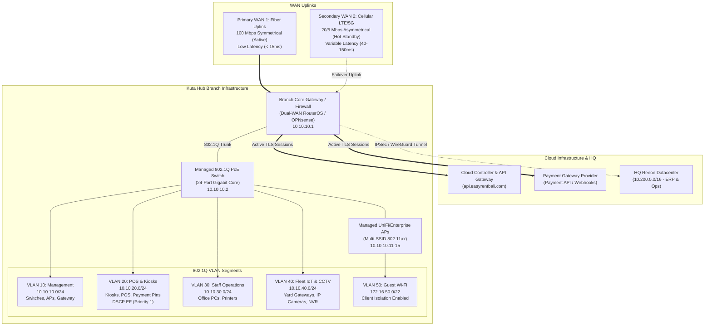

# Easy Rent Bali – Branch Infrastructure & Network Failover Architecture

**Document ID:** `NET-ARCH-KUTA-001`  
**Location:** Kuta Hub Branch, Bali, Indonesia  
**Scope:** Local Infrastructure, 802.1Q Segmentation, Inter-VLAN Firewall, Dual-WAN Failover, and Emergency QoS  
**Target RTO (Failover Time):** $< 3$ seconds  
**Author:** Lead DevOps & Infrastructure Engineer  
**Status:** Approved for Implementation  

---

## 1. Executive Summary & Outage Context

The **Kuta Sunset Outage (18:30 WITA)** demonstrated a critical vulnerability in the branch network:
1. Physical severance of the primary fiber link forced the gateway to fall back to a high-latency, jittery cellular link (WAN2).
2. Unthrottled guest Wi-Fi clients consumed the limited cellular bandwidth, causing packet loss and bufferbloat.
3. Kiosks and POS terminals failed to complete checkout requests, initiating aggressive retry storms that produced deadlocks and duplicate payments.
4. The local IoT gateway dropped telemetry streams, leaving returning rental cars untracked.

This document establishes the authoritative network architecture designed to isolate failure domains, prioritize business-critical transactions, automate deterministic sub-3-second failover, and protect uplink bandwidth during emergency cellular operation.

---

## 2. High-Level Network Topology



---

## 3. 802.1Q VLAN Matrix & IP Plan

All internal subnets follow strict RFC 1918 allocations. No management interface is exposed directly to any client VLAN or the public internet.

| VLAN ID | Segment Name | Target Subnet | Gateway | DHCP Scope | Static Reservations & Exclusions | DNS Servers | Security Policy | Default QoS (DSCP) |
| :---: | :--- | :--- | :--- | :--- | :--- | :--- | :--- | :--- |
| **10** | Management | `10.10.10.0/24` | `10.10.10.1` | `10.10.10.50 - 10.10.10.100` | `.1` Router, `.2` Switch, `.11-.20` APs, `.21-.30` NVR/Gateways | `10.10.10.1` (Local forwarder to `1.1.1.1`) | Strictly Isolated. Accessible only via Bastion/Admin jump host. | DSCP CS6 (48)<br>Network Control |
| **20** | POS & Kiosks | `10.10.20.0/24` | `10.10.20.1` | `10.10.20.10 - 10.10.20.100` | `.1` Gateway, `.101-.150` Static Payment Terminals | `10.10.20.1` (Encrypted DoH proxy) | Strict Isolation. Outbound restricted to whitelisted payment & booking APIs. | DSCP EF (46)<br>Expedited Forwarding |
| **30** | Staff Operations | `10.10.30.0/24` | `10.10.30.1` | `10.10.30.10 - 10.10.30.200` | `.1` Gateway, `.201-.220` Printers, Scanners, Local NAS | `10.10.30.1` | Internal Office. Outbound web filtered; IPSec access to HQ Renon. | DSCP AF21 (18)<br>Standard Business |
| **40** | Fleet IoT & CCTV | `10.10.40.0/24` | `10.10.40.1` | `10.10.40.50 - 10.10.40.200` | `.1` Gateway, `.10-.20` Base Gateways, `.21-.40` IP Cameras, `.45` NVR | `10.10.40.1` | No public ingress. CCTV isolated to local NVR. IoT outbound to cloud telemetry only. | DSCP AF31 (26) Telemetry<br>DSCP CS1 (8) CCTV |
| **50** | Guest Wi-Fi | `172.16.50.0/22` | `172.16.50.1` | `172.16.50.10 - 172.16.53.250` | `.1` Gateway, `.2-.9` Infrastructure reserve | `1.1.1.1`<br>`8.8.8.8` | Client-to-client isolation. Zero access to internal subnets. Throttled/Dropped on WAN2. | DSCP BE (0)<br>Best Effort |

---

## 4. Firewall Architecture & Inter-VLAN Routing

### 4.1 Zone-Based Security Architecture
The gateway enforces a strict **Default-Deny** model across all inter-VLAN and ingress boundaries:
$$\text{Action}(\text{Traffic}) = \begin{cases} \text{ACCEPT} & \text{if explicitly matched by whitelist rule} \\ \text{DROP} & \text{default} \end{cases}$$

### 4.2 Comprehensive Inter-VLAN Firewall Rules

| Rule ID | Source Zone / Subnet | Destination Zone / Subnet | Protocol & Port | Action | Justification / Description |
| :---: | :--- | :--- | :---: | :---: | :--- |
| **FW-01** | Any internal VLAN | Firewall Local Interface | UDP 53, 67 | `ACCEPT` | Allow DHCP allocation and DNS resolution on local gateway IPs. |
| **FW-02** | VLAN 30 (Staff Admin IP) | VLAN 10 (Management) | TCP 22 (SSH), 443 (HTTPS) | `ACCEPT` | Authorized administrative access to switch and router management consoles. |
| **FW-03** | Any non-admin IP | VLAN 10 (Management) | ANY | `DROP` | Block all unauthorized attempts to contact management interfaces. |
| **FW-04** | VLAN 20 (POS & Kiosks) | WAN (Cloud Booking API) | TCP 443 | `ACCEPT` | Allow checkout kiosks to communicate with `api.easyrentbali.com`. |
| **FW-05** | VLAN 20 (POS & Kiosks) | WAN (Payment Gateways) | TCP 443 | `ACCEPT` | Allow credit card terminal transactions with payment acquirers. |
| **FW-06** | VLAN 20 (POS & Kiosks) | All Internal Subnets (`10.0.0.0/8`, `172.16.0.0/12`) | ANY | `DROP` | Isolate POS & Kiosks from staff, guests, and IoT devices. |
| **FW-07** | VLAN 40 (Fleet IoT GW) | WAN (Cloud Telemetry Ingest) | TCP 8883 (MQTTS), 443 | `ACCEPT` | Allow branch IoT gateway to stream vehicle telemetry to the cloud ingest queue. |
| **FW-08** | VLAN 40 (IP Cameras) | VLAN 40 (Local NVR `.45`) | TCP 554 (RTSP), 8000 | `ACCEPT` | Allow CCTV cameras to stream video feeds to the local on-premise NVR. |
| **FW-09** | VLAN 40 (All devices) | WAN (Public Internet) | ANY | `DROP` | Prohibit direct internet access for IP cameras (prevent botnet exploit and bandwidth waste). |
| **FW-10** | VLAN 30 (Staff) | HQ Renon (`10.200.0.0/16`) | ANY (via IPSec) | `ACCEPT` | Allow staff workstations to access corporate ERP and booking management systems. |
| **FW-11** | VLAN 30 (Staff) | WAN (Public Internet) | TCP 80, 443 | `ACCEPT` | Allow general staff web browsing (with web-filtering proxy). |
| **FW-12** | VLAN 50 (Guest Wi-Fi) | Private Subnets (`10.0.0.0/8`, `172.16.0.0/12`, `192.168.0.0/16`) | ANY | `DROP` | **Strict Guest Isolation:** Drop all attempts to reach internal corporate infrastructure. |
| **FW-13** | VLAN 50 (Guest Wi-Fi) | WAN (Public Internet) | TCP 80, 443, UDP 53 | `ACCEPT` | Allow internet-only browsing for branch customers (subject to WAN2 rate limiting). |
| **FW-14** | WAN (Internet Ingress) | Any Internal VLAN | ANY | `DROP` | Strict stateful drop for all unsolicited incoming connections. |

---

## 5. Dual-WAN Failover & Flap-Damping Architecture

### 5.1 Failover Target: Sub-3-Second ($< 3$s) Switchover
To prevent transaction dropouts during link severing, the gateway executes continuous asynchronous synthetic health checks:

- **Target 1:** `1.1.1.1` (Cloudflare Primary Anycast DNS) via WAN1 Gateway.
- **Target 2:** `8.8.8.8` (Google Primary Anycast DNS) via WAN1 Gateway.
- **Target 3:** `api.easyrentbali.com` (Cloud Controller Health Probe) via WAN1 Gateway.

#### Timing Parameters:
- **Probe Interval:** $1000\text{ ms}$ (1 probe every second).
- **Timeout per probe:** $500\text{ ms}$.
- **Failure Trigger Threshold:** 3 consecutive missed probes OR packet loss $\ge 60\%$.
- **Detection Latency:** $3 \times 1000\text{ ms} = 3.0\text{ seconds}$ maximum failover trigger window.
- **Switch Action:** Gateway automatically adjusts the routing table distance, lowering the default route preference of WAN1 from Distance 1 to Distance 250, causing the kernel to immediately forward egress packets via WAN2 (Cellular LTE/5G).

```mermaid
sequenceDiagram
    autonumber
    participant GW as Core Gateway (Kuta Hub)
    participant WAN1 as Primary Fiber WAN1
    participant WAN2 as Cellular Backup WAN2
    participant Cloud as Cloud Booking API

    GW->>WAN1: Ping Probe (1.1.1.1 / 8.8.8.8) [T = 0s]
    WAN1-->>GW: ACK (RTT 12ms) - Healthy
    Note over WAN1: Thunderstorm: Fiber cable severed physically
    GW->>WAN1: Ping Probe [T = 1s]
    Note right of WAN1: Timeout (Packet Dropped)
    GW->>WAN1: Ping Probe [T = 2s]
    Note right of WAN1: Timeout (Packet Dropped)
    GW->>WAN1: Ping Probe [T = 3s]
    Note right of WAN1: Timeout (Packet Dropped) - Threshold Reached!
    
    rect rgb(255, 230, 230)
    Note over GW: FAILOVER TRIGGERED (&lt; 3.0s)<br>1. Disable WAN1 Default Route<br>2. Elevate WAN2 to Distance 1<br>3. Engage Emergency QoS Profile (Throttle VLAN 50)
    end

    GW->>WAN2: Forward POS & Kiosk Traffic [T = 3.2s]
    WAN2->>Cloud: TLS Checkout Request
    Cloud-->>WAN2: HTTP 200 Confirmed
    WAN2-->>GW: Forward Response to Kiosk
```

### 5.2 Hysteresis (Flap-Damping) Mechanism
A major root cause of the Kuta Sunset Outage was connection flapping: the severed fiber link momentarily reconnected, causing the router to switch back to fiber, only for the link to immediately collapse again.

**Flap-Damping Policy:**
- **Recovery Threshold:** WAN1 must exhibit **30 continuous seconds** of uninterrupted probe responses ($30/30$ ACKs) with average latency $< 35\text{ ms}$ and $0\%$ packet loss before being restored as the primary default route.
- If a single probe is lost during the 30-second trial window, the timer resets to zero, keeping the branch securely on WAN2 backup until the fiber connection is truly stable.

### 5.3 Limitations of Sub-3-Second Failover
1. **Public IP Change:** WAN1 and WAN2 have different public IP addresses. Stateful TCP connections (such as raw database sockets or active TLS handshakes in flight at the exact moment of severance) will reset (`TCP RST`). Kiosks and POS clients must implement application-level exponential backoff retry.
2. **Cellular Jitter:** Cellular networks inherently experience higher latency fluctuations ($40-300\text{ ms}$) during severe storm conditions.

---

## 6. WAN2 Emergency Traffic Shaping & QoS Policy

### 6.1 The Two QoS Operating Modes

> [!IMPORTANT]
> **Diferensiasi Kritis Kebijakan Bandwidth:**
> - **Normal Mode (WAN1 Active):** VLAN 50 (Guest Wi-Fi) menggunakan *Per-Client Token Bucket Rate Limiting* sebesar **2 Mbps per client** (total bandwidth fiber 100 Mbps).
> - **Emergency Mode (WAN2 Active):** VLAN 50 (Guest Wi-Fi) dialihkan ke *Emergency Aggregate Queue* sebesar **$< 128\text{ kbps}$ untuk seluruh klien tamu** atau dinonaktifkan (blackhole), memastikan 100% kapasitas uplink seluler 5–10 Mbps dialokasikan untuk POS, Kiosks, dan IoT.

### 6.2 Traffic Priority & DSCP Classification Matrix

| Priority Queue | Traffic Class / Subnet | DSCP Marking | WAN1 Guaranteed Bandwidth | WAN2 Emergency Guaranteed Bandwidth | WAN2 Priority Action |
| :---: | :--- | :---: | :---: | :---: | :--- |
| **P1 (Highest)** | VLAN 20: POS Terminals & Checkout Kiosks | **DSCP EF (46)** | 10 Mbps | 5 Mbps | **Zero Throttling.** Guaranteed dedicated egress queue. |
| **P2** | VLAN 10: Router & Switch Cloud Controller Heartbeats | **DSCP CS6 (48)** | 2 Mbps | 1 Mbps | High priority queue to prevent remote management disconnection. |
| **P3** | VLAN 40: Fleet IoT Telemetry Gateway | **DSCP AF31 (26)** | 5 Mbps | 2 Mbps | Sustained telemetry queue to maintain real-time vehicle location tracking. |
| **P4** | VLAN 30: Staff Corporate Web & ERP (HQ Renon) | **DSCP AF21 (18)** | 20 Mbps | 2 Mbps | Low-latency corporate queue; non-critical downloads dropped. |
| **P5 (Dropped)** | VLAN 40: CCTV Streaming / NVR Cloud Sync | **DSCP CS1 (8)** | 15 Mbps | **0 kbps (BLOCKED)** | CCTV outbound sync to cloud is paused; streams remain local on NVR. |
| **P6 (Emergency)** | VLAN 50: Guest Wi-Fi Network | **DSCP BE (0)** | 2 Mbps / client | **$< 128\text{ kbps}$ Aggregate** | **Strict Aggregate Shaper.** Dropped to 128 kbps or captive portal displays maintenance notice. |

---

## 7. Concrete Router Implementation (MikroTik RouterOS / Vendor-Neutral)

Below is the verified RouterOS v7 configuration illustrating recursive routing failover, dynamic mangle marking, and WAN2 emergency queue enforcement:

```routeros
# ====================================================================
# 1. 802.1Q VLAN Interfaces & Subnet Configuration
# ====================================================================
/interface vlan
add interface=bridge-lan name=VLAN10_MGMT vlan-id=10
add interface=bridge-lan name=VLAN20_POS  vlan-id=20
add interface=bridge-lan name=VLAN30_STAFF vlan-id=30
add interface=bridge-lan name=VLAN40_IOT   vlan-id=40
add interface=bridge-lan name=VLAN50_GUEST vlan-id=50

/ip address
add address=10.10.10.1/24 interface=VLAN10_MGMT
add address=10.10.20.1/24 interface=VLAN20_POS
add address=10.10.30.1/24 interface=VLAN30_STAFF
add address=10.10.40.1/24 interface=VLAN40_IOT
add address=172.16.50.1/22 interface=VLAN50_GUEST

# ====================================================================
# 2. Sub-3-Second Recursive Failover Routing with Hysteresis
# ====================================================================
# Synthetic Canary Targets: 1.1.1.1 (Target 1) and 8.8.8.8 (Target 2)
/ip route
# Primary Fiber WAN1 (Distance 1 - Active)
add dst-address=1.1.1.1/32 gateway=192.168.1.1 scope=10 comment="Canary Probe WAN1 A"
add dst-address=8.8.8.8/32 gateway=192.168.1.1 scope=10 comment="Canary Probe WAN1 B"
add dst-address=0.0.0.0/0 gateway=1.1.1.1 check-gateway=ping distance=1 target-scope=11 comment="Primary Fiber Default Route"

# Secondary Cellular WAN2 (Distance 2 - Standby)
add dst-address=0.0.0.0/0 gateway=192.168.2.1 distance=2 comment="Cellular WAN2 Hot-Standby"

# ====================================================================
# 3. QoS DSCP Packet Marking (Mangle)
# ====================================================================
/ip firewall mangle
# POS & Kiosks: Expedited Forwarding (DSCP 46 / EF)
add chain=prerouting src-address=10.10.20.0/24 action=set-priority new-priority=6 passthrough=yes
add chain=prerouting src-address=10.10.20.0/24 action=change-dscp new-dscp=46 passthrough=yes comment="Mark POS/Kiosk DSCP EF"

# Fleet IoT Telemetry: AF31 (DSCP 26)
add chain=prerouting src-address=10.10.40.0/24 dst-port=8883,443 protocol=tcp action=change-dscp new-dscp=26 passthrough=yes comment="Mark IoT Telemetry AF31"

# Guest Traffic: Best Effort (DSCP 0)
add chain=prerouting src-address=172.16.50.0/22 action=change-dscp new-dscp=0 passthrough=yes comment="Mark Guest Best Effort"

# ====================================================================
# 4. Emergency Dynamic Queue Shaper for WAN2 Failover
# ====================================================================
/queue tree
add name="Q_POS_RESERVED" parent=global packet-mark="" priority=1 limit-at=5M max-limit=10M comment="Guaranteed POS Queue"
add name="Q_GUEST_EMERGENCY" parent=global packet-mark="" priority=8 limit-at=64k max-limit=128k disabled=yes comment="WAN2 Emergency Guest Shaper"

# Netwatch Script executing state-switch upon WAN1 failure/recovery
/tool netwatch
add host=1.1.1.1 interval=1s timeout=500ms \
    down-script="/queue tree enable [find comment='WAN2 Emergency Guest Shaper']; /log warning 'WAN1 DOWN! Switched to WAN2. Guest Wi-Fi throttled to < 128 kbps.'" \
    up-script="/queue tree disable [find comment='WAN2 Emergency Guest Shaper']; /log info 'WAN1 RESTORED! Resuming normal bandwidth allocations.'"
```

---

## 8. Operational Recovery & Post-Incident Runbook

When a storm-induced failover occurs, on-duty IT Support must follow this operational procedure:

1. **Verify Active Uplink Status:**  
   Check router dashboard or run `/ip route print where active=yes`. Confirm if the active default route points to WAN1 or WAN2.
2. **Confirm POS Operation:**  
   Ensure that the POS terminals and Kiosks report status `ONLINE` and that checkout latency is $< 800\text{ ms}$ over the cellular link.
3. **Verify Guest Throttling:**  
   Confirm that guest Wi-Fi throughput does not exceed $128\text{ kbps}$ aggregate. If cellular signal drops below $-100\text{ dBm}$ RSRP, activate firewall rule `FW-12-EMERGENCY` to temporarily disable guest traffic entirely.
4. **Monitor Fiber Stabilization:**  
   Observe the 30-second flap-damping window. Do not manually force traffic back to WAN1 until ISP technicians confirm physical line restoration.
5. **Post-Failback Verification:**  
   Once the fiber connection is restored, verify that telemetry gateways reconnect and that the guest Wi-Fi returns to normal 2 Mbps per-client operation.
